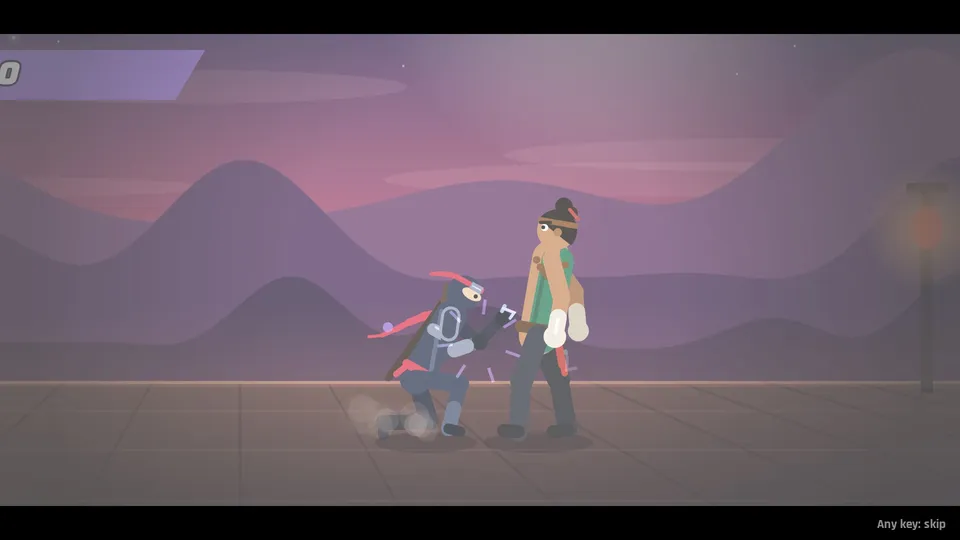
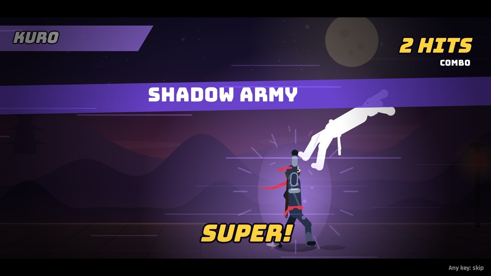
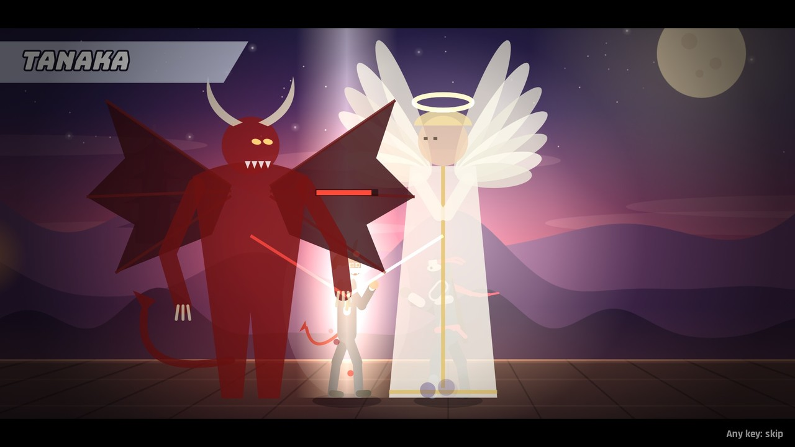
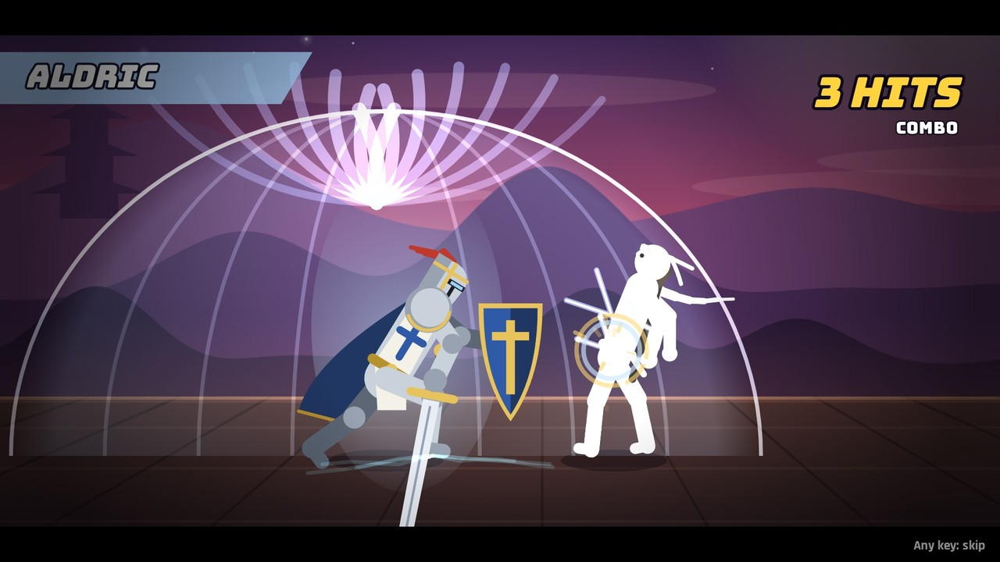
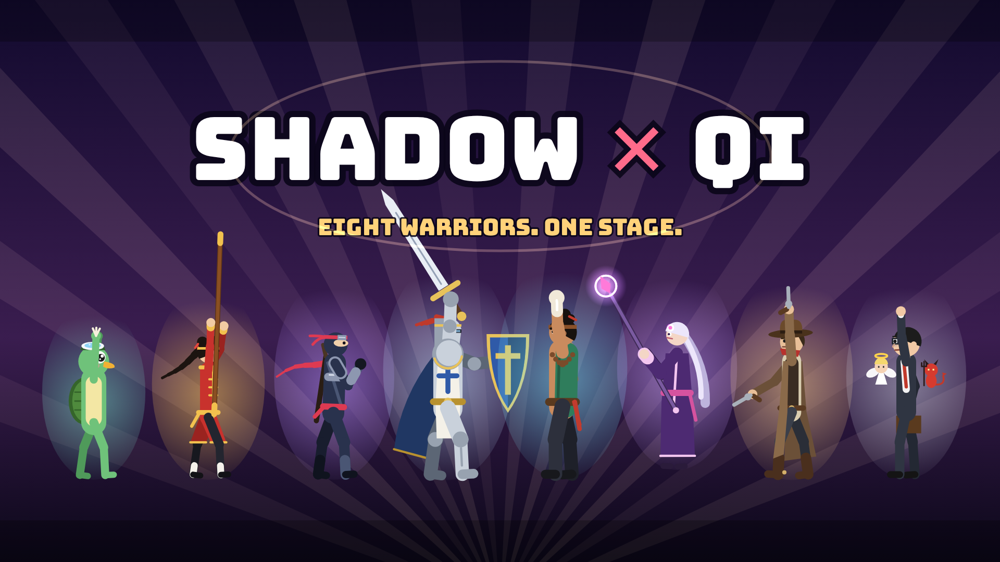

  

<h1 align="center">Shadow ✕ Qi</h1>

<b>A 2D fighting game that runs in your browser.</b> 
Nine fighters · combos & supers · CPU battles (4 difficulties) · training · real-time online battles · 日本語 / English

<a href="https://cn-eveer.github.io/shadow-qi/"><b>▶ Play now</b></a>

---

## The fighters

| | Fighter | Style |
|---|---|---|
| 🥷 | **Kuro** — Shadow Ninja | hand signs and spirit beasts, vanishing attacks, kunai juggles |
| 👊 | **Tetsu** — Qi Brawler | qi palms and beams; armor on his heavy techniques |
| 🥢 | **Mei** — Staff Prodigy | long reach with the bo staff, cloud jumps, double jump |
| 🔮 | **Lyra** — Psychic Sage | magic circles and falling crystals from across the screen |
| 🛡️ | **Aldric** — Holy Paladin | Excalibur's aura, shield guard, Rampart Charge with armor |
| 🐸 | **Kappa** — Mythic Kappa | dish water, shell tricks, poison, and a riptide (← ← + K) that drags runaways back |
| 🤠 | **Jesse** — Gunslinger | quick draw from the holster, charge shots, aimed juggles — ten bullets, then a five-second reload |
| 💼 | **Tanaka** — Salaryman | office supplies — and angel, devil, or **double** possession |
| 🪨 | **Hohen** — Golem Doctor | duets with his stone golem (U / I its blows, J / K his own stones), a solid golem to jump or break, and stone armour that locks on piece by piece |

    

## Features

- **Combos and supers** — strings, launchers, juggles, bounces, charge attacks and a super for every fighter
- **Readable fights** — technique tells, armor, counters, punish windows, high / low guarding, visible wake-up invincibility
- **Every super can be escaped** — the four biggest can only be guarded; the rest come out after an invincible wind-up and can be jumped over or dashed away from (a hint shows which)
- **CPU battles** on four difficulties: かんたん / ふつう / むずかしい / 地獄 (Easy / Medium / Hard / Hell)
- **Training** with a move card that shows one move at a time (name and command) to practise each one, and a label on every hit showing how high the attack reached (上段 / 上中段 / 中段 / 中下段 / 下段 — it can be switched off in ⚙ Settings)
- **Sample combos and punishes** for every fighter, played out with the inputs on screen — including a *max combo* for each
- **Online battles** — random match or a room number, browser to browser
- An **opening movie** drawn live in the game engine, **entrance poses** before every round, and **victory animations**: three per fighter by health left, plus a match-win celebration
- **Sound** — a piano score that builds into a climax as the round heats up, an announcer (“Round 1! Fight! … Player 1 wins!”), and hit sounds that match each fighter's weapon
- **Japanese by default**, English one tap away
- **Release notes in the game** (更新情報, in Japanese) and the version in Settings; when a new version is live, the game asks you to reload without the browser's cache, or to erase the site's data and reload
- **Plays on phones and tablets** — hold the phone sideways; add it to your home screen to play full screen

## How combos work

A combo can **lift** (L) and **bounce** (B) the opponent only in these orders, each followed by a finisher:

| | Pattern |
|---|---|
| lift → lift + finisher | L L |
| lift → lift → bounce + finisher | L L B |
| lift → bounce + finisher | L B |
| lift → bounce → lift + finisher | L B L |
| bounce → bounce + finisher | B B |
| bounce → lift + finisher | B L |

- **U, U, I** in a juggle is a lift. It only raises them while it fits the patterns above; past that, they drop out of the combo (“LIFT LIMIT” / “BOUNCE LIMIT”) and can't be hit until they land.
- **U, U** in the air doesn't raise them: it holds them for a moment (less with every attack), and after the second lift it brings them down — only the finisher is left.
- **Damage drops as the combo goes on**: the first hit is full, the second does 90%, then 8% less per hit; hits after the second lift or bounce do 60% on top of that.
- No juggle lasts more than 5 seconds, and ground strings can't be looped: hit-stun shrinks after the first few hits, a string (U, U, U, U, K or a shorter one, J, J, K) can't be started over into itself, and when it ends its user stops for breath and can't attack until the opponent has been free for a moment. A single U or J that hits or is guarded leaves a short gap too.
- **Guarding is a guess**, by attack height: *high* attacks pass over a crouching fighter; *high + mid* and *mid* ones are stopped by either guard; *mid + low* ones — launchers rising off the floor, rising juggles, bounces and drops, and swings that reach the legs — hit a crouching guard (“MID + LOW!”); *low* ones — sweeps and slides, even those that launch — need a crouching guard. Mid, mid + low and low attacks can all be jumped over. Training shows each attack's height as it lands.

Every fighter's sample combos (title screen → *combos*) show these patterns, the max combos included.

## Controls

**Keyboard**

| Move | Keys |
|---|---|
| Walk / jump / crouch | A D / W / S — or the arrow keys (crouch + forward edges forward) (hold back to guard standing: everything but lows; back + down to guard crouching: lows and mids, but not mid + lows) |
| Light / heavy punch | U / I |
| Light / heavy kick | J / K |
| Techniques | tap forward twice (→ →) or back twice (← ←) + a button; some also have ↑, ↓ or → versions |
| Super | U + J together (when the MP gauge is full: it turns gold and reads **MP MAX**) |
| Pause | Esc |

**Phone or tablet** (hold it sideways): the pad on the left moves you (tap it twice quickly for → → or ← ←), the U I / J K buttons are on the right, and ❚❚ pauses. On most phones (wider than 16:9) the controls sit in panels beside the game, not over it; on 16:9 phones and tablets they sit over the game. The game keeps the same size in menus, fights and pauses, and menus shrink to fit if the screen is small.

**⚙ Settings**: sound, music (BGM), language, attack heights in training (on or off), CPU difficulty, each fighter's full move list, the version and its release notes (更新情報), and buttons to reload around the browser's cache or erase the site's saved data.

## Put it online with GitHub Pages

1. Create a new **public** repository (for example `shadow-qi`).
2. Upload **everything in this folder** — `index.html`, `version.json`, `manifest.webmanifest`, `.nojekyll`, `README.md` and the `css`, `js` and `assets` folders — to the root of the repository (*Add file → Upload files → Commit*).
   Tip: `.nojekyll` starts with a dot, so your computer may hide it; it is fine to skip it if you can't see it.
3. Open **Settings → Pages**, set **Source: Deploy from a branch**, **Branch: main**, folder **/ (root)**, and **Save**.
4. After a minute the game is live at `https://<your-name>.github.io/<repository>/`.

To update later, upload the changed files over the old ones, and for every release:

- raise the version number in `index.html` (every `?v=…` after a `.js` or `.css` file name), so browsers load the new files instead of the ones they kept from last time;
- put the same number in `version.json` — anyone who still has the old version open is asked to reload;
- add the release notes, in Japanese, at the top of `RELEASES` in `js/updates.js` (they show in the game under 更新情報).

> If your address isn't `cn-eveer.github.io/shadow-qi`, change the addresses near the top of `index.html` (`canonical`, `og:url`, `og:image` and `twitter:image`) so link previews show the cover image.

## Where things are

The scripts are plain `<script>` files that share one scope, loaded in the order below — there's no build step: open `index.html` and play.

| File | What's in it |
|---|---|
| `index.html` | the page itself: header, game screen, training buttons and the settings drawer |
| `css/style.css` | all styles, including the phone layout and touch controls |
| `js/movelist/*.js` | each fighter's move list, English and Japanese (one file per fighter, plus `controls.js`) |
| `js/setup.js` | constants, the skeleton and every pose |
| `js/charge-attacks.js` | held (charged) heavy attacks |
| `js/characters.js` | the first eight fighters: stats, colours, move sets |
| `js/moves.js` | every move's timing, hitboxes and effects |
| `js/input-cpu.js` | keyboard input, the CPU opponent and its difficulty levels |
| `js/demos.js` | sample combos and punishes |
| `js/state.js` | game state, the fighter update, the lift / bounce rules (`RISE_PATTERNS`) and the rest after a string |
| `js/hits.js` | hit detection, guarding by attack height, damage and combo scaling, the training height labels |
| `js/projectiles.js` | projectiles and special-move helpers |
| `js/strings.js` | each fighter's combo strings |
| `js/particles-rounds.js` | particles and the round flow |
| `js/pose-select.js` | which pose a fighter shows each frame |
| `js/victory.js` | round-win animations (three per fighter, by health left) and match-win celebrations |
| `js/draw-fighters.js` | drawing the fighters |
| `js/draw-effects-hud.js` | drawing effects, the stage and the HUD |
| `js/opening.js` | the render loop and the opening movie (prologue, highlight reel, finale) |
| `js/online.js` | online play (PeerJS / WebRTC) |
| `js/audio.js` | sound effects, the announcer and the music |
| `js/alchemist.js` | Hohen and his golem: moves, the golem, the armour, his drawing, sample combos and his CPU plans |
| `js/updates.js` | the version, the release notes (更新情報) and the update check |
| `js/menus.js` | menus, keyboard, settings, touch controls, training move card |
| `version.json` | the version that's live, for the update check |

---

